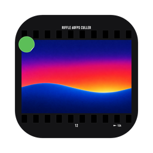

<p align="center"></p>

<p align="center"><a href="./README.md">English</a> | 日本語</p>

# Handpic

撮った RAW をすばやく見ていき、残すものと捨てるものを決めるためのセレクトアプリです。

- RAW に埋め込まれた JPEG プレビューだけを読むので、数千枚のフォルダーでも、写真を切り替えるたびに待たされることがありません。
- スター、採用 / 不採用、カラーラベルは、Lightroom など XMP サイドカーを読むソフトや DxO PhotoLab が読めるサイドカーファイルに書き込みます。RAW ファイル自体には一切書き込みません。
- 現像も編集もしません。やることは「選ぶ」ことだけです。

対応形式は[対応状況](#対応状況)を、確認済みのカメラは [docs/humans/cameras.ja.md](./docs/humans/cameras.ja.md) を参照してください。

## はじめに

### インストール

現在のアプリのパッケージはまだリリースしていません。リリースまでは、[CONTRIBUTING.md](./CONTRIBUTING.md)（英語）の手順でソースからビルドしてください。[Releases ページ](https://github.com/minodisk/handpic/releases)のパッケージ（1.10.0 まで）は、このアプリが置き換えた以前のアプリのもので、このアプリへはアップデートされません。新しくインストールしたときに以前のインストールから引き継ぐものは [docs/humans/usage.ja.md](./docs/humans/usage.ja.md#インストール) を参照してください。

### 最初の一歩

1. 設定（`Cmd+,` / `Ctrl+,`、またはタイトルバーの右端の歯車）を開き、`Sidecar` ページで使っている現像ソフトを選びます。Lightroom（XMP、デフォルト）、DxO PhotoLab、またはその両方です。Lightroom の場合は、カラーラベルの名前を合わせるために Lightroom の表示言語も選びます。
2. フォルダーをウィンドウにドロップします（`Cmd+O` / `Ctrl+O` でも開けます）。メモリーカードから始めるときは、設定の `Import` ページでコピー先を選び、フォルダーツリーでカードを右クリックして `Import…` を選びます。コピーの実行中に最初の日付フォルダーが開きます。
3. `←` `→` で前後の写真に切り替え、`1`-`5` でスターを付け、`x` で不採用にします。
4. ピントが怪しいときは `z` で等倍表示にして、フォーカス位置を確認します。

判定はその場でサイドカーに保存されるので、保存操作はいりません。終わったら Lightroom など XMP サイドカーを読むソフトや DxO PhotoLab がそのまま取り込みます。

### ワークフローの例

1. カメラの RAW フォルダーを開いてカリングします。残す写真にスターを付け、それ以外は `x` で不採用にします（[主な機能](#主な機能)）。
2. Lightroom や DxO PhotoLab でフォルダーを開くと、判定がサイドカーから取り込まれます（[他のソフトとの連携](#他のソフトとの連携)）。残した写真を現像して JPEG で書き出します。
3. フォルダーツリーで書き出し先のフォルダーを右クリックして `Sequence JPEG Timestamps…` を選び、`<フォルダー>-sequenced/` を作ります（[主な機能](#主な機能)）。
4. `<フォルダー>-sequenced/` を Handpic で開きます。閲覧専用で開くので、並び順を確かめられます（[主な機能](#主な機能)）。
5. `<フォルダー>-sequenced/` を Google フォトにアップロードします。

## 主な機能

- **フォルダーツリー**: 左ペインでホームとマウント中のボリュームをたどり、フォルダーをクリックすると開きます。クリックするとツリーがキーボードを受け取り、`ArrowUp` / `ArrowDown`、`Home` / `End`、`Space`、`Enter`、名前の入力でフォルダーを移動、展開して開けます。`Escape` を押すまでカリングのキーは効きません（`←` / `→` ではストリップを送れます）。フォルダーを右クリックすると、Finder / エクスプローラー / ファイルマネージャーでそのフォルダーを表示したり、パスや名前をコピーしたり、`Rename…` で名前を変えたり、`Rename by Capture Date…` で写真の撮影日の名前にしたり（`YYYY-MM-DD` のフォルダー 1 つに、撮影日が複数にわたるときは日付ごとの隣のフォルダーに分けます）、`Rewrite Sidecars from Index…` で Handpic のインデックスからサイドカーを書き直したり（判定だけを書き換えるので、Lightroom や PhotoLab の編集は残ります）、`Delete Sidecars…` でサイドカーをゴミ箱に移したりできます。開いているフォルダーの名前をゆっくり 2 回クリックしても名前を変えられます。名前はその場で編集し、`Enter` かほかの場所をクリックすると確定、`Escape` で取り消します。インデックス、レーティング、最後に見ていた位置もフォルダーについていき、開いていたフォルダーなら新しい名前で開き直します。
- **カードからのインポート**: フォルダーツリーでメモリーカードや任意のフォルダーを右クリックして `Import…` を選ぶと、その RAW ファイル、JPEG、RAW の隣のサイドカーを、設定の `Import` ページのルートとパターン（デフォルトは `%Y/%F` で、`2026/2026-10-24` のようになります）の下に、撮影日ごとのフォルダーに分けてコピーします。動画はコピーせず、カードの中身は変更しません。プレビューにコピーする内容を一覧し、すでにあるものは飛ばし、同じ名前でサイズが違うファイルは一覧して上書きせず、撮影日のないファイルは一覧して飛ばします。実行が始まると最初の日付フォルダーが開き、ファイルが届くにつれて埋まるので、コピーの間にカリングを始められます（[詳しくはこちら](./docs/humans/usage.ja.md#機能)）。
- **フィルムストリップ**: 下端にサムネイルが並び、クリックで表示します。`Cmd+クリック` / `Ctrl+クリック` で 1 枚ずつ追加・解除、`Shift+クリック` や `Shift+←` / `Shift+→` で範囲選択、`Cmd+A` / `Ctrl+A` でフィルターが表示しているすべてを選択でき、判定は選択中のすべてに適用されます。右クリックして `Move to Trash…` を選ぶと、数を確認したうえで、そのファイルか選択全体をサイドカーと一緒にゴミ箱に移します（不採用で絞り込んですべてを選択すれば、不採用をまとめて片付けられます）。削除はしないので、`Cmd+Z` / `Ctrl+Z` 1 回で移動をまるごと判定とともに取り消せ、`Cmd+Shift+Z` / `Ctrl+Shift+Z` でもう一度ゴミ箱に移します。ディスクの空きがないときは、`Delete Permanently…` で移動の代わりにサイドカーごと完全に削除できます。こちらは取り消せず、確認ダイアログではマウスのクリックでしか実行できません。右クリックメニューからは、ファイルを Finder / エクスプローラーで表示したり、パスやファイル名を（選択中なら選択したすべてのファイルのものを 1 行に 1 つずつ）コピーしたり、表示中のファイルの状態にチェックが付いたフラグ、スター、カラーラベルを付けたりもできます。`Ctrl+Alt+ArrowDown`（macOS では `Alt+Cmd+ArrowDown`）でフィルムストリップ、`…ArrowLeft` でフォルダーツリー、`…ArrowRight` でメタペイン、`Tab` で左右両方のペインを隠し、ビューアを広げられます。ペインの端をドラッグすると大きさを変えられます。メタペインの `Maker note` グループには、Sony の AF、ドライブ、手ブレ補正、画作りの設定を表示します。
- **等倍ピントチェック**: `z` でフォーカス位置を中心に等倍表示します。別の写真に切り替えてもズームは保たれます。
- **フォーカスピーキング**: `e` で、プレビューと等倍表示の上に画像の強いエッジを赤く重ね、ピントの合った面がひと目でわかります。
- **フォーカスマーク**: `f` で、AF 枠を記録するカメラではカメラが使った AF 枠と、そのフォーカス位置の十字を表示します。位置だけを記録するカメラでは十字のみ、AF 位置のないカメラやマニュアルフォーカスの写真では何も表示しません（[カメラが記録する情報](./docs/humans/cameras.ja.md)）。マークの色は AF 点に最も近い顔を、AF 点がないときやマニュアルフォーカスでは Handpic がプレビュー全体で見つけた最も大きい顔を判定するので、そうしたコマも十字は出ませんが明るい緑にもグレーにもなります。良い写真、つまり失敗ではない可能性が高いコマならマークは明るい緑です。ファイルのフルサイズの埋め込み JPEG で目がシャープで（小さいプレビューでは隠れる甘さが見えるためで、シャープネス 0.162 以上）、目が開いていて（開き具合 41 以上）、顔がカメラを向いていて（左右 35° 以内、上下 45° 以内）、フェイスメッシュが顔に合っていて、顔が画像の端で切れていないコマです。顔を判定し、その目がフルサイズではっきり甘い（シャープネス 0.110 未満）コマはグレー、それ以外（その間の顔や良い写真の基準に届かない顔、プレビューより大きい JPEG がなく測れないファイル（RAF、ORF、HDR PQ の CR3、α7R IV や α6400 のように最大の埋め込み JPEG がプレビューである Sony の機種）、AF 点の近くに、AF 点がなければプレビュー全体に顔が見つからない、まだ計算していない）は白になります。どちらのしきい値も 1 機種（ILCE-7M5）で決めました。良い写真のしきい値は 3 フォルダーと、別の手作業でラベル付けしたセットで確かめました。後者では、良い写真の 145 コマのうち、作者がしきい値未満でもシャープと判断したのは 5 コマで、シャープなコマが少し良い写真から外れることがあります。高 ISO では甘いコマを見逃します。グレーのしきい値は、作者がピント面が目にあるかどうかで評価した 281 コマで決めました。ピントが合っている 154 コマのうち 3 コマと、はっきり外れている 88 コマのうち 13 コマがその下に入るので、グレーは失敗のすべてではなく、はっきり甘いコマを表します。これらのコマでは、フルサイズのシャープネスは、置き換えたプレビューでの合焦確率よりもピントの合ったコマをよく見分けました（AUC 0.69 対 0.62）。明るい緑はわざと絞り込んでいて（その 154 コマのうち 29 コマがシャープネスの基準だけで外れます）、良い写真だけを表します。顔が見つからないコマは白のままです。作者のフォルダーでは、そうしたコマでシャープネスのスコアが採用したコマとそれ以外をほとんど見分けられなかったためです。カメラの顔追尾はマークの色に影響しなくなりました。この判定はサムネイルの直後に 2 回目のパスで、画面に見えているファイルから順に計算するため、進むにつれてマークが白から変わります（どちらのパスも通常より低い優先度で動くため、CPU を取り合うときはビューアが優先されます）。ストリップでは明るい緑とグレーのセルの左下にマークの色のアイコン（良い写真は笑った顔、グレーは口角の下がった顔、白は無し）が付き、メタペインにはその目のフルサイズでのシャープネスを `Eye focus` として、その顔の目が開いているかどうかと開き具合（0〜100）を `Eyes` として、その顔のヨー、ピッチ、ロールを `Yaw`、`Pitch`、`Roll` として表示します（どれも判定の対象の顔について同じ 2 回目のパスで保存します）。フィルターメニューの `Face focus` セクション（`Good` / `Neutral` / `Low`）でこの状態ごとに、`Eyes` セクション（`Open` / `Closed` / `Unknown`）で保存した目の状態ごとに絞り込めます（顔が見つからない写真など、保存した値のないファイルは `Unknown` です）。マークは Handpic が AF 点の近くで検出した顔も、シアンの枠と、両目、鼻の先、口の両端のシアンの点、枠の横のラベル（検出スコア、枠の大きさ、両目の間の距離。プレビューのピクセル単位）で表示します。検出はコマの表示時に行うため、`f` を押してから少し遅れて現れます。`Eyes` の行で判定した顔には、その行より少し遅れて顔のパーツ（輪郭、目、眉、鼻、唇）の線と、目が開いていると判定したときは虹彩もマゼンタで表示します。
- **オフライン顔検出**: 顔と目は同梱の [YuNet](https://github.com/opencv/opencv_zoo/tree/main/models/face_detection_yunet) モデル（MIT ライセンス）で検出します。表示中のファイルの被写体が目を閉じているかは、同梱の [MediaPipe Face Landmarker](https://ai.google.dev/edge/mediapipe/solutions/vision/face_landmarker) の顔メッシュ（Apache-2.0、Google の TFLite から ONNX に変換）で判定します。どちらもローカルで動き、ネットワークにはアクセスしません。ストリップのフォーカスマークのアイコン（フィルターメニューの `Good`、`Low` 項目にも表示）は [Lucide](https://lucide.dev) の `scan-face` と、その口を下向きにしたもの（ISC ライセンス）です。
- **HDR PQ (HEIF) の CR3 プレビュー**: HDR PQ をオンにして撮った Canon CR3 の HEVC プレビューは、同梱の [hpvcd](https://github.com/awxkee/hpvcd)（BSD-3-Clause OR Apache-2.0）でデコードします。
- **連写**: 1 秒以内に撮られたコマはストリップ上で帯と枚数バッジでまとめられます。`ArrowUp` / `ArrowDown` で連写間を移動、`Alt+ArrowLeft` / `Alt+ArrowRight` で連写内のコマを順に移動して端で止まり、`Shift+x` で連写の残りを不採用にします。1 秒未満の撮影時刻を記録しないカメラでは秒単位でまとめます（[カメラが記録する情報](./docs/humans/cameras.ja.md)）。
- **JPEG の撮影時刻の連番化**: Handpic でカリングし、残した写真を RAW 現像ソフトから JPEG で書き出したら、フォルダーツリーで書き出し先のフォルダーを右クリックして `Sequence JPEG Timestamps…` を選ぶと、連写の撮影時刻が 1 秒ずつずらされます。1 秒未満の時刻を無視する Google フォトでも、コマが撮影順に並びます。並び順は撮影時刻、1 秒未満の時刻、ファイル名の順で決まるため、2 台のカメラから書き出したフォルダーでも正しく交互に並びます。書き込む前に新しい時刻をプレビューで確認できます。結果は書き出し先フォルダーの隣の `<フォルダー>-sequenced/` に完全なコピーとして書き出され、実行が終わるとそのフォルダーがファイルマネージャーで表示されます。元のファイルには一切手を加えません。もう一度実行すると、元の時刻からコピーを作り直します。
- **JPEG だけのフォルダー**: `<フォルダー>-sequenced/` の書き出し結果のように JPEG だけが入ったフォルダーは閲覧専用で開くので、並び順と撮影時刻を Handpic の中で確かめられます。サムネイル、プレビュー、EXIF の行を撮影時刻順に表示します。スター、フラグ、カラーラベル、サイドカー、ピント候補の表示はありません。
- **外観**: 設定の `Appearance` ページで、システムのライト / ダークに従うか、どちらかに固定するかを選び、それぞれのテーマを選べます。ウィンドウは前の位置に、最後に開いていたフォルダーとペインの状態のまま開きます。
- **MCP コンパニオン**: AI アシスタントなどの MCP クライアントが、カリングに付き添えます。Handpic が表示している内容を読み、プレビューを見て、表示を動かし、キーと同じ経路でスター、採用 / 不採用、ラベルを付け、メニューの操作を始められます。デフォルトはオフで、このコンピューター内からしか接続できません。クライアントが求めたゴミ箱への移動やフォルダーの操作は、設定の `MCP` ページで許可しない限り Handpic のダイアログであなたの確認を待ち、完全な削除は常にあなたに確認します（[MCP コンパニオン](#mcp-コンパニオン)）。

すべての機能と、キーの一覧は [docs/humans/usage.ja.md](./docs/humans/usage.ja.md) で説明しています（[キー](./docs/humans/usage.ja.md#キー)）。

## 他のソフトとの連携

判定は RAW の隣のサイドカーファイルに保存されます。形式は設定の `Sidecar` ページで選びます（選ぶまでは Lightroom (XMP) です）。

- **Lightroom (XMP)**: `FOO.ARW` に対して `FOO.xmp` を作ります。Lightroom などが読む形式です。採用 / 不採用は `xmpDM:good` に、カラーラベルは Lightroom と同じく `photoshop:LabelColor` と `xmp:Label` の両方に書き込みます。`xmp:Label` に書く名前は色ごとに設定で変えられます。
- **PhotoLab (.dop)**: `FOO.ARW` に対して `FOO.ARW.dop` を作ります。採用 / 不採用もここに入ります。
- **Both**: 判定を `FOO.xmp` と `FOO.ARW.dop` の両方に書き込みます。一度のカリングで Lightroom と PhotoLab の両方で現像できます。フォルダーを開いたときは 2 つのうち最後に更新された方を読むので、どちらのソフトで後から編集しても反映されます。Both に切り替えても既存のファイルは書き換えないので、判定し直すまでは 1 枚の 2 つのサイドカーの内容が食い違うことがあります。

他のソフトが作ったサイドカーはその場で編集します。スター、フラグ、ラベル以外（現像設定、キーワードなど）には手を触れません。

同じフォルダーにある、名前が同じで拡張子だけが違う 2 つの RAW（`FOO.ARW` と `FOO.DNG`）は `FOO.xmp` を共有するため、サポートしていません。一方をゴミ箱に移すと、共有の `FOO.xmp` も一緒に移り、もう一方の判定も持っていかれます。完全に削除する場合は、共有の `FOO.xmp` を残します。RAW ごとに `FOO.ARW.dop` を作る PhotoLab (.dop) 形式だけを最初から使い、フォルダーに `FOO.xmp` を置かないか（**Both** では共有の `FOO.xmp` も書き込みます。また、選んだ形式にかかわらず、既存の `FOO.xmp` はゴミ箱への移動でも一緒に移ります）、そうした RAW を別々のフォルダーに分けてください。

### Lightroom

- Lightroom（Classic ではないもの）は、写真を読み込むときに Handpic が書いた XMP を読みます。
- Lightroom で変更したスター、フラグ、カラーラベルは、Lightroom 自身が RAW の隣の `.xmp` に書き戻します。Lightroom Classic と違い、`Ctrl+S` や自動書き出しの設定はいりません。Handpic はフォルダーを開いたときにその変更を読み込みます。
- Windows 版の Lightroom 9.5.1 で確認しています。

### Lightroom Classic

- Lightroom Classic は、写真を最初に読み込むときに Handpic が書いた XMP を読みます。
- 読み込み後は、Handpic が変更したサイドカーを再読み込みしません（再起動しても同じです）。選択中の写真だけなら、ライブラリのグリッドで写真を右クリックして `Metadata > Read Metadata from File` を選びます。フォルダー全体なら、フォルダーを右クリックして `Synchronize Folder...` を選び、`Scan for metadata updates` にチェックを入れて `Synchronize` をクリックしてください。
- Lightroom Classic はデフォルトでは XMP を書き出しません。`Ctrl+S`（`Metadata > Save Metadata to File`）で選択中の写真に書き出すか、`Catalog Settings > Metadata > Automatically write changes into XMP` をオンにしてください。
- カラーラベルは Lightroom Classic のカラーラベルセット（`Metadata > Color Label Set > Edit...`）と名前で照合されます。セットのラベル名を `Red`、`Yellow`、`Green`、`Blue`、`Purple` に変えるか、Handpic の設定でラベル名をセットの名前に合わせてください。Lightroom の各言語版のデフォルトセット用のプリセットを用意しています（Lightroom Classic が提供するすべての UI 言語）。言語の追加は [JSON ファイル 1 つ](./crates/core/i18n/README.md)で済みます。

### DxO PhotoLab

- PhotoLab は `.dop` の中の識別子で画像を見分けます。PhotoLab が一度見た画像（`.dop` が書かれていなくても、フォルダーを開くだけで該当します）に、PhotoLab の知らない識別子の `.dop` を新しく作ると、Handpic の判定を持った仮想コピーとして取り込まれ、マスターは元の状態のままになります。
- そこで Handpic は `.dop` を新しく作るときに PhotoLab のデータベース（Windows では最も新しい `%APPDATA%\DxO\DxO PhotoLab N\Database\PhotoLab.db`、macOS では最も新しい `~/Library/DxO PhotoLab vN/DOPDatabaseVN.dopdata`）から画像の識別子を読んで書き込みます。PhotoLab は判定をマスターに反映します。macOS では `/Volumes` 以下のフォルダーはまだ検索せず、ランダムな識別子のままになります。
- データベースが見つからないとき（PhotoLab が入っていないとき）も、新しい `.dop` はそのまま使えます。PhotoLab はマスターとして取り込みますが、すでにその画像を見ていた場合は判定が仮想コピーに入ります。
- すでにある `.dop` は、これまでどおりその場で編集します。
- Windows 版の PhotoLab 10.0.1 で確認しています。

### MCP コンパニオン

Handpic は [MCP](https://modelcontextprotocol.io/) のエンドポイントを提供でき、MCP クライアント（AI アシスタントなど）をカリングの相棒にできます。デフォルトはオフです。設定の `MCP` ページで `Let MCP clients connect` をオンにすると、サーバーはすぐに起動し、以後の起動時にも起動します。同じページにアドレスと動作中かどうかが表示されます（[docs/humans/usage.ja.md](./docs/humans/usage.ja.md#mcp-コンパニオン)を参照）。サーバーはこのコンピューター内だけで次の URL を待ち受けます。

```text
http://127.0.0.1:41917/mcp
```

Streamable HTTP で MCP を話すクライアントなら、この URL だけで接続できます。例を 2 つ挙げます。

- **Claude Code**:
  `claude mcp add --transport http handpic http://127.0.0.1:41917/mcp`
- **Claude Desktop**: `claude_desktop_config.json` に次を追加します。`npx -y mcp-remote` を経由するので Node.js が必要です（`url` を直接書く形は検証していません）。

  ```json
  {
    "mcpServers": {
      "handpic": {
        "command": "npx",
        "args": ["-y", "mcp-remote", "http://127.0.0.1:41917/mcp"]
      }
    }
  }
  ```

各ツールの動作は [docs/humans/usage.ja.md](./docs/humans/usage.ja.md#mcp-コンパニオン) で説明しています。

## 対応状況

チェックのないものはまだ検証できていません。使ってみた結果の報告は大歓迎です。

### OS

- macOS（Apple Silicon）
  - [x] 26
- Windows
  - [x] 11
- Linux
  - [x] Ubuntu

動いた場合は Discussions の[OS 動作報告スレッド](https://github.com/minodisk/handpic/discussions/286)に投稿してください。動かない場合は[OS 用の issue テンプレート](https://github.com/minodisk/handpic/issues/new?template=os.yml)から issue を立ててください。

### RAW 形式

- ARW
- CR3
- DNG
- NEF
- ORF
- RAF

JPEG（`.jpg` / `.jpeg`）だけが入り、RAW ファイルを含まないフォルダーは閲覧専用で開きます。サムネイル、プレビュー、EXIF の行を撮影時刻順に表示し、スター、フラグ、カラーラベル、サイドカー、ピント候補の表示はありません。

実際のファイルで確認したカメラ、カメラごとに記録している情報、それによって変わる機能は [docs/humans/cameras.ja.md](./docs/humans/cameras.ja.md) にまとめています。対応状況を形式ごとではなくカメラごとに載せている理由は [docs/humans/raw-formats.ja.md](./docs/humans/raw-formats.ja.md) で説明しています。

[docs/humans/cameras.ja.md](./docs/humans/cameras.ja.md) に載っていないカメラで動いた場合は Discussions の[カメラ動作報告スレッド](https://github.com/minodisk/handpic/discussions/287)に投稿してください。動かない場合は[カメラ用の issue テンプレート](https://github.com/minodisk/handpic/issues/new?template=camera.yml)から issue を立ててください。調査にはサンプルファイルが必要なので、添付（またはリンク）をお願いします。1 枚で十分ですが、できれば横位置と縦位置の 2 枚があると、回転とフォーカスマークも確認できます。

### サイドカー形式とソフト

- XMP
  - [x] Adobe Lightroom
  - [x] Adobe Lightroom Classic
- DOP
  - [x] DxO PhotoLab

Handpic で付けたスター、フラグ、カラーラベルがソフト上で正しく表示された場合は、Discussions の[ソフト動作報告スレッド](https://github.com/minodisk/handpic/discussions/288)に投稿してください。表示されない場合は[ソフト用の issue テンプレート](https://github.com/minodisk/handpic/issues/new?template=software.yml)から issue を立ててください。

## 開発者向け

- ソースからのビルド: [CONTRIBUTING.md](./CONTRIBUTING.md)（英語）
- パフォーマンス計測: [docs/humans/performance.ja.md](./docs/humans/performance.ja.md)
